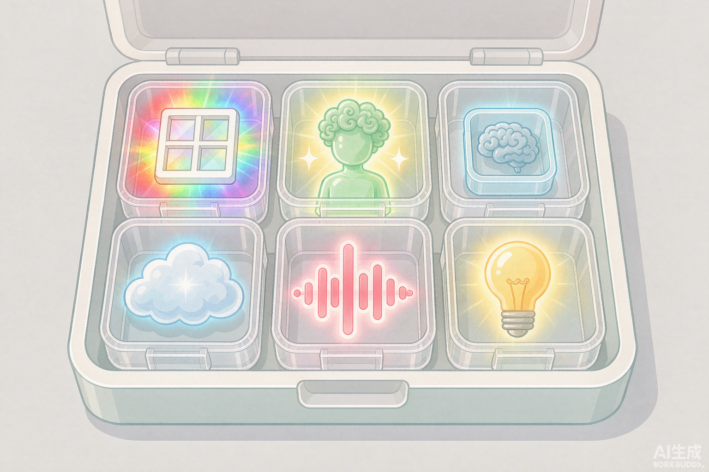
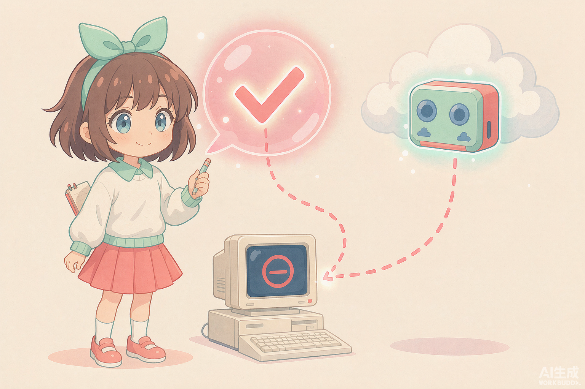

> 最近刷到可以聊天的 AI 桌面女友，感觉挺好玩的。就是那种一直浮在桌面角落、会眨眼、你发句话她就回、偶尔还主动找你搭讪的二次元小人。
>
> 研究了一圈才发现，这东西听着玄，做起来没那么神。它本质就是几个成熟技术拼到一块：一个透明窗口负责长在桌面上，一个会聊天的模型负责脑子，再加点 Live2D 动画和语音就活了。最值钱的部分不是模型多强，而是你给她的人设和记忆。
>
> 下面跟着我把她从架构拆到落地，你看完大概也能自己搭一个。

## 一、拆开看：它到底是什么

所谓「AI桌面女友」，剥掉外壳就是四层东西叠在一起：

- **视觉层**：一个常驻桌面的透明窗口，里面是 Live2D 或序列帧角色。不占任务栏，永远浮在最上面。
- **交互层**：眼睛跟鼠标、能拖拽、能点击，进阶的还会定时截屏「看」你在干啥，主动找你搭话。
- **大脑层**：一个会聊天的 LLM（大语言模型）。角色的性格、称呼、说话方式，全靠一段 System Prompt 定下来。
- **语音层**：把文字变成声音（TTS），进阶的还能用你的参考音频克隆出特定声线（ASR 负责听你说话）。

拆开看，它就是**透明窗口 + 一个 LLM + 可选的 Live2D 和语音**。这股风起来，靠的是三件事同时成熟，Live2D 免费模型放开、低价 LLM 接口普及、本地语音克隆变简单，缺一不可。

## 二、每一层用什么：技术选型

| 层 | 作用 | 主流方案 | 说明 |
|---|---|---|---|
| 外壳/桌面框架 | 透明置顶窗口、托盘、气泡 | Electron（最常见）、WPF/C#、Flutter、Qt | Electron 写 UI 快、跨平台、生态全，是绝大多数开源项目的选择 |
| 渲染 | 画出会动的角色 | Live2D Cubism SDK + PixiJS、或序列帧/GIF、或视频 | Live2D 是「灵动感」的来源，官方 Sample 模型可直接用 |
| 眼睛追踪 | 角色眼睛跟鼠标 | Live2D 的 eyeBall 参数绑鼠标坐标 | 几十行代码，体验提升最大 |
| 大脑 | 生成对话 | 任意 OpenAI 格式接口（DeepSeek / GPT / Gemini / 本地 Ollama） | System Prompt 定人设 |
| 记忆 | 记住你 | 短期=对话历史；长期=SQLite + 向量 RAG | 让她跨会话记得你的职业和偏好 |
| 视觉感知 | 主动搭话 | 定时截屏 → 视觉模型识别 → 生成问候 | 烧 API 费用，注意隐私 |
| 语音输出 | 说话声 | VOICEVOX（日语）、GPT-SoVITS / Fish Speech（中文克隆）、Edge TTS | 中文克隆需自备参考音频 |
| 语音输入 | 听你说话 | Whisper 本地、MASR、云 ASR | 语音唤醒靠后台流式识别 |

## 三、别从零造：能直接用的开源轮子

四个有代表性的实现，架构都验证过：

- **Live2DPet**（x380kkm）：Electron + Live2D + VOICEVOX，带截屏感知、关键帧视觉记忆、情绪系统，架构最完整，MIT 协议。
- **momo-desktop-pet**：Electron + Live2D 的 Demo/MVP，内置 AI 聊天 + 语音 + 长期记忆，适合入门读源码。
- **chatgpt-desktopPet**（kirbystudy）：经典模板，含 VITS 语音、壁纸、日程等扩展点。
- **Petto**：Flutter + Dart，以插件形式对接 Live2DViewerEX 的 ExAPI，支持语音唤醒，GPL3.0。

想快点看到效果，直接 clone 一个、配好 API Key 就能跑。想深度定制，从 Live2DPet 的架构抄起最省事。

## 四、本地跑模型，还是接 API Key

桌面女友的「大脑」只有两条路，选哪条基本就决定了你对电脑的要求。

**路线 A：本地跑模型**（比如用 Ollama 拉一个 7B 模型）
推理全在本机，数据不出门，也不用花钱买 API。代价是吃硬件，一个 7B 模型至少得 4–6GB 显存才能流畅对话，14B 往上基本得配独立显卡加 8GB 以上显存。也就是得有一台正经独显的机器，老笔记本和普通办公本基本带不动。

**路线 B：接云端 API Key**（DeepSeek / GPT / Gemini，都是 OpenAI 兼容格式）
推理在服务商机房，本机只发请求、收回答，对电脑几乎零要求。十年前的集显本、甚至一台树莓派都能跑，因为它根本不靠你本地算力。代价是要联网、按量付费（纯聊天很便宜，带「看屏幕」的视觉感知才烧钱），数据会出本机。

怎么选，想完全离线、数据敏感，又有独显机器，走 A；只想低成本、机器一般，走 B。大多数人走 B 就行，大脑交给云端，本机只管把角色画出来、把声音放出来。

## 五、最小可跑通路径

照这个顺序，半天能跑起来一个会动、会聊的：

1. **壳**：`npm init` + Electron，建一个 `transparent: true, frame: false, alwaysOnTop: true` 的窗口。
2. **画**：下载 Live2D 官方免费 Sample 模型，用 `pixi-live2d-display` 加载进透明窗口。
3. **聊**：写一个调用 OpenAI 兼容接口的模块，把角色人设写进 System Prompt。
4. **动**：让 LLM 返回的情绪标签映射到 Live2D 的 `motion` / `expression`（比如 `[happy]` → 微笑动作）。
5. **声（可选）**：接 Edge TTS 或本地 GPT-SoVITS，把文本合成语音；口型用 Live2D 的 `mouthOpenY` 参数随音频能量驱动。
6. **记（可选）**：SQLite 存长期记忆，每次对话前捞相关片段拼进 Prompt。

## 六、几个容易踩的坑

- **透明窗口 + 点击穿透**：要让角色可拖、但空白处不挡鼠标，需用 `setIgnoreMouseEvents` 配合命中检测区分「角色区可点/背景穿透」。
- **隐私合规**：定时截屏感知功能默认会把屏幕发到第三方 API，自己玩要心里有数，闭源产品这是红线。
- **Live2D 模型版权**：官方 Sample 仅限非商用学习；要分发必须拿到模型作者授权，否则只让用户自己导入。
- **语音克隆门槛**：中文声线克隆需要 1–5 分钟干净参考音频 + 一次本地训练，不是开箱即用。
- **API 成本**：带视觉感知的循环截屏很烧钱，必须设最小间隔 + 本地缓存。

---

说到底，「AI桌面女友」真不是什么黑科技，就是几样成熟技术拼一起。模型反而不是最值钱的，你给她的人设和记忆才是。有空自己搭一个，比光看别人玩有意思。

我是 Leo，一个努力让生活变得更美的人。
