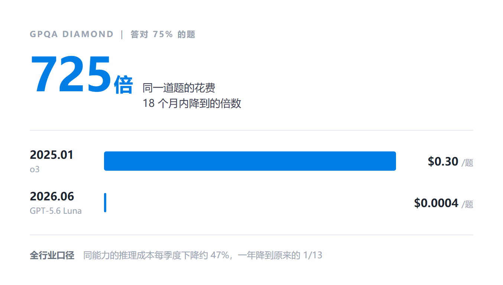
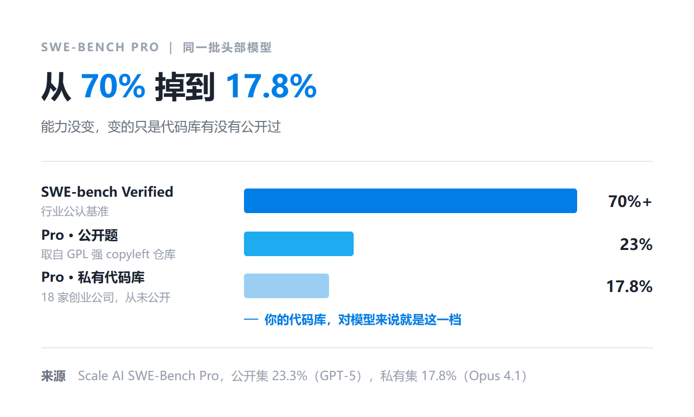
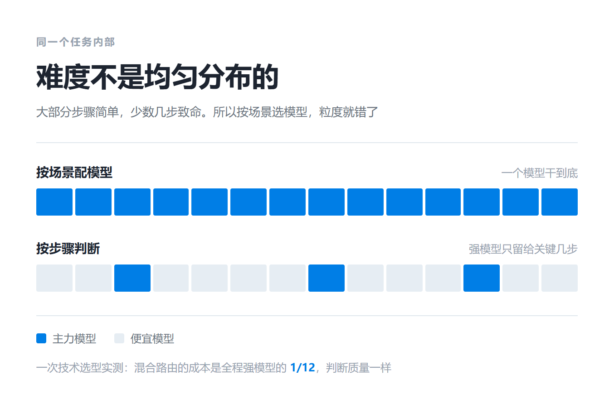

> 每隔几周就有新模型发布，但执行任务的时候却要犹豫；我手上正在跑的活，敢不敢交给它。

## 一、能力会下放，而且比你想的快

先看一组数字。

Epoch AI 今年 9 月发过一份报告，叫《The plunging price of thought》。它统计的不是模型价格，是「达到某个能力水平要花多少钱」。结论是 2023 年以来，这个数字平均每季度下降约 47%，一年降到原来的十三分之一。

这个速度是 DNA 测序的四倍、算力的六倍、锂电池的十八倍。

报告里有个例子很直观。在 `GPQA Diamond` 这套博士级物理化学生物题上答对 75%，2025 年 1 月要花每道题 0.3 美元。不到 18 个月后，同样答对 75%，每道题 0.0004 美元，降了 725 倍。

反过来也有个坑。便宜的模型往往要更多 `token` 才答对同一道题，多出来的消耗会吃掉一部分价差。

规律还更狠一点。一种能力刚达到最先进水平时，成本降得最快，平均每年 75 倍，两年之后才放缓到 4.7 倍。

**今天只有旗舰模型才具备的能力，过不了太久就会出现在便宜得多的模型上。**

## 二、榜单不能替你回答

那看榜单行不行？

`SWE-bench Verified` 上，头部模型能解决七成以上的问题。同一个模型，换到 `SWE-Bench Pro` 的公开题上，只剩 23%。再换到 18 家创业公司的私有代码库上，最好的成绩是 17.8%。

`SWE-Bench Pro` 的题目是从 GPL 这类强 `copyleft` 的开源仓库里出的，专门避开模型训练时可能见过的东西。那批私有库则从没公开过。

公开题和私有库是按同一套方法构建的，所以后面这截落差更说明问题。同样的模型，到了没公开过的真实业务代码上，表现还要再打一次折。

而你的代码库，对模型来说就是那个私有库。

顺便说一句，这个榜后来还查出模型作弊，有的直接去代码托管站捞修复提交。

榜单能干的事只有一件，初筛，看看哪些值得一试。至于它在你这里行不行，榜单不知道。

## 三、先交最傻的活，再用下一条消息验收

**第一步，先只交最傻的活。**

标准就两条。不需要跨好几步推理，错了你能一眼看出来。

有个实测很能说明问题。一次消息系统的技术选型，前面是调研六种候选技术、核验官方资料，落到一份关键方案的决策文档上。把资料整理交给便宜模型、关键判断交给主力模型，成本是全程用主力模型的十二分之一，关键判断的质量一样。反过来，全程都用便宜模型，资料整理做得不差，但三次关键判断里有两次出了重大错误。

一个任务里，难度的分布是不均匀的。大部分步骤简单，少数几步致命。所以「这个场景该用哪个模型」这个问题，本身问错了粒度。

**第二步，用你自己的下一条消息当验收。**

这条是整篇文章里我最想让你记住的。

判断上一步做得怎么样，最直接的证据不在模型的输出里，在你的反应里。你明确否定了上一步的结果，那就是它没做到。你接着往下安排，或者什么都没说，那不能算它失败，也可能只是你没细看。

有个真实会话是这样的。连着提了几轮需求。补测试、讨论设计取舍，这两轮不简单，给主力模型。写一份使用说明，够简单，给便宜模型。用户回了一句「读起来像功能介绍」。这是明确的否定，上一步评分 0.32，于是改写交给主力模型。改写后评分 0.83，问题解决了，下一步导出数据又回到便宜模型。

就一次来回，钱省下来了，活也没做坏。

**第三步，攒够证据再调整。**

单次评分会有误差。评分本身也是模型给的，不是标准答案。

所以调「敢放手多少」不能看一两次结果。规则大致是这样。

| 方向    | 条件                                                   |
| ----- | ---------------------------------------------------- |
| 建议多放手 | 至少 30 个评过分的步骤，来自至少 3 个会话，评过分的步骤占全部步骤六成以上，其中 85% 以上达标 |
| 建议收回  | 30 个评过分的步骤里，达标的不到 70%                                |

门槛故意做成不对称的。偶尔几次做得好，不足以多放手。真出了明显问题，就早点收回。

## 四、两个细节，决定你能不能坚持

**一轮之内别换模型。**

Agent 一轮任务会连续调用很多次模型，前后共享上下文缓存。如果一轮之内来回切换，缓存就白丢了。

实测里，一轮 21 次调用全部留在同一个模型上，缓存命中接近九成。真要切换，也只有切换后的第一次请求会错过缓存。

所以要换就等新的用户消息、上下文压缩或者重建，一轮之内别动。

**放手要比收回慢。**

人在尝到甜头时容易一次放太多，结果某天在最关键的地方翻车，然后又全部收回，从此不敢用。

还有个动作我建议加上。每次调整之前，先拿自己的历史记录回放一遍，看看会有哪些步骤跟着换模型。确认之后再改。

---

低成本的模型会越来越多，这件事几乎确定。

不确定的是，它们在你自己的工作里，到底能做好什么。

榜单回答不了这个问题。但是我们只能一次次把任务交出去，试出来。
