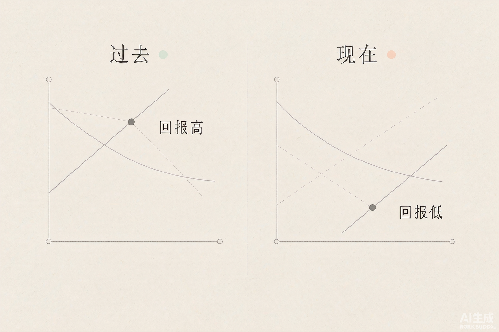
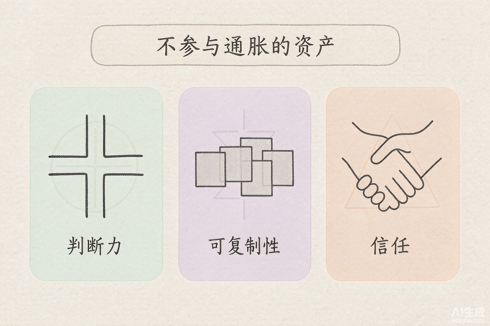

> 努力从来没有贬值。贬值的，是「和大家一样的那份努力」。

## 01 你不是不够努力，是努力的购买力下降了

先说一件容易被误解的事。

一个人加班到十点，方案改了七版，最后被评价「还不够亮眼」。他的第一反应通常是：我不够努力。

但把这句话换个说法，结论就完全不一样了：

**不是他不够努力，是他那份努力的购买力下降了。**

同一个「努力」的动作，五年前能换到一次晋升，现在只能换到「没被批评」。动作没变，投入甚至更多了，换回来的东西却变少了。

这就是通胀式努力。不是努力这个行为失效了，而是努力作为通货，被超发了。

在货币世界里，如果市面上的钱多了一倍，而商品还是那些商品，结果只有一个——同样的钱，买不到同样的东西。努力也一样。当所有人都加大投入，而「好结果」的总量没有变多时，单位努力的回报必然下降。

**你没有变差，是计价方式变了。**

## 02 通胀是这样发生的

努力的通货膨胀不是意外，它有三个稳定的发动机。

==第一个：可度量的努力会被批量生产。==

一旦某种投入能被量化——工时、打卡、证书数量、发文篇数、代码行数——它就会被制度化为考核指标。而任何被当作指标的东西，都会被大量生产出来。**指标一旦诞生，超发就只是时间问题。**

==第二个：努力的信息变得廉价。==

过去你熬夜做出来的东西，只有你和同事知道。现在每一种努力都可以被展示：朋友圈的深夜工位、社交平台上的学习打卡、简历里密密麻麻的项目。当展示努力的成本趋近于零，努力就失去了「稀缺信号」的作用。**所有人都在证明自己努力，等于没有人能证明。**

==第三个：标准化的赛道必然超发。==

如果一条路被公认为「正确的路」，那它一定拥挤。考编、考证、转码、做自媒体——每一个被公开验证过成功的赛道，都会在短时间内涌入远超其容量的人数。**赛道越正确，超发越严重。**

三个引擎叠加，结果就是：你越努力，努力的边际回报越低。这不是道德问题，是供给问题。

## 03 它和内卷不是一回事

这两个词经常被混用，但视角完全不同。

内卷描述的是**竞争结构**：蛋糕没有变大，分蛋糕的人却在互相加码。它的核心是「总量不增长」。

通胀式努力描述的是**定价机制**：努力这种通货超发了，所以每一份努力都变便宜了。它的核心是「货币太多」。

差别在哪里？如果只是内卷，解法是跳出这张牌桌。但通胀式努力告诉你一件更不舒服的事：**换一张桌子，如果那张桌子上的努力同样在超发，你只是换了个地方贬值。**

内卷问的是「跟谁比」。通胀式努力问的是「我手里的东西，发行量有多大」。

## 04 谁在这场通胀里损失最大

通胀从来不会均匀地伤害所有人，它做的其实是重新分配。

==损失最大的是刚入场的人。==

一个工作了十五年的人，手里握着的是过去以「高价」兑换来的存量：职位、人脉、信任、行业认知。这些都是在努力还值钱的时候攒下来的。

而刚入场的人，手里只有刚印出来的钞票——最新的学历、最新的证书、最新学会的技能。这些恰恰是发行量最大的东西。**你付出的是同样的努力，但你的努力是在通胀最严重的时候被定价的。**

==其次是只有努力这一种资产的人。==

如果一个人全部的投入方式都是「多花时间和精力」，那么当努力贬值时，他没有别的资产可以对冲。这就像把全部积蓄都存成一种正在超发的货币。

==相对有利的，是持有不可批量生产之物的人。==

判断力、审美、信任、独特的经历、可以复制的资产——这些东西没法被「生产」出来，所以它们不参与这场通胀。

## 05 三种抗通胀资产

顺着上面的逻辑，可以列出三类不会随努力超发而贬值的资产。

==判断力。==

判断力无法批量生产，因为它的前提是「见过足够多的样本，并且自己承担过后果」。你可以一天读完一百篇攻略，但读不出判断力。**在一个所有人都更努力的世界里，判断「该往哪里努力」比努力本身更稀缺。**

==可复制性。==

一份需要你亲自到场才能交付的努力，回报上限就是你本人。而一段代码、一篇文章、一个产品、一笔资本，可以在你睡觉的时候继续工作。**可复制的东西，投入不随产出线性增长——这是唯一能跑赢通胀的结构。**

==信任。==

信任是唯一一种「发行量」由别人决定的货币。你无法通过努力制造更多信任，只能通过长期一致的行为积累。正因为它不能被超发，所以它一直在升值。

## 06 三条可操作的路径

不需要立刻辞职或者改变人生。三件很小的事。

==一、换计价单位。==

不要总在别人定的指标上竞争。如果所有人都在比谁写得多，那就去比谁的判断更准；如果所有人都在比谁更拼，那就去比谁更早看清方向。**换一个别人还没想起来去超发的维度，你原来的努力就重新变得值钱。**

==二、在超发的方向上，主动减少投入。==

这条反直觉，但它是通胀环境下最有效的一步。当所有人都在同一个方向加码，那个方向上努力的边际回报已经趋近于零。这时候最有价值的动作，恰恰是不参与。**别人越努力的地方，你的「不努力」反而越值钱——因为他们把竞争的成本抬高了，而你没有付这个成本。**

==三、每次努力，问它留下了什么可复用的东西。==

把努力的产出从「一次性交付」改成「可积累的资产」。同样三个小时，写成一份只能汇报一次的文档，和写成一份以后能反复引用的方法论，价值差着几个数量级。**努力会贬值，但它沉淀下来的东西不一定。**

## 结语：你是你努力的发行方

把努力看成货币，看问题的角度就变了。

以前你问的是：我还能不能再努力一点？
现在你该问的是：我手里这份努力，发行量有多大？

前一个问题没有上限，所以你永远觉得自己不够。
后一个问题有明确答案，而且你多少能控制它——**因为你的努力印了多少张，很大程度上是你自己决定的。**

努力本身没有错。但在一次通胀里，最危险的不是不努力，而是拼命多印同一种钞票。

我是 Leo，一个努力让生活变得更美的人。如果你觉得今天这篇有收获，欢迎**点赞、在看、转发**三连，我们下篇见。
